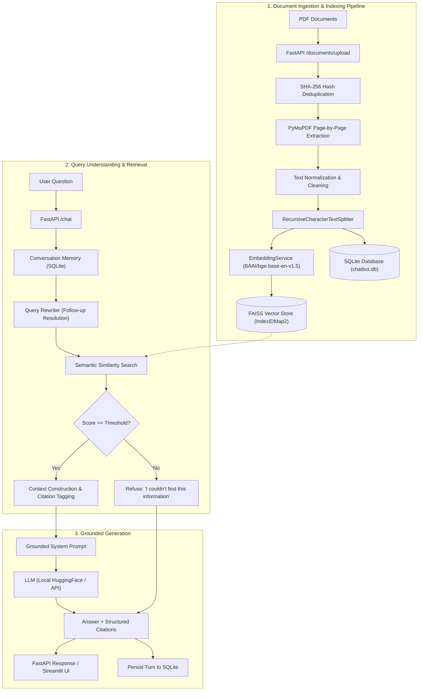

# Intelligent PDF Knowledge Assistant – RAG

A production-ready, full-stack Retrieval-Augmented Generation (RAG) Document Chatbot designed to ingest single or multiple PDF documents, extract and chunk text with strict page-level metadata retention, generate dense vector embeddings, and deliver factually grounded, verifiable answers with interactive citations.

[](assets/intelligent_pdf_rag_demo.mp4)
[](https://python.org)
[](https://fastapi.tiangolo.com)
[](https://streamlit.io)
[](tests/)

> 🎬 **Demo Video**: Watch the high-resolution demonstration walkthrough in [`assets/intelligent_pdf_rag_demo.mp4`](assets/intelligent_pdf_rag_demo.mp4).

---

## 🌟 Key Features

- **Multi-Document PDF Ingestion**: Upload individual or batches of PDFs with SHA-256 deduplication to prevent redundant indexing.
- **Accurate Text Extraction**: Page-by-page extraction via PyMuPDF (`pymupdf`) with graceful handling of empty or scanned pages.
- **Semantic Text Chunking**: Configurable `RecursiveCharacterTextSplitter` preserving rich metadata (`document_id`, `filename`, `page_number`, `chunk_id`).
- **Dense Vector Embeddings**: Utilizes state-of-the-art `BAAI/bge-base-en-v1.5` with L2 normalization, in-memory caching, and batch encoding.
- **FAISS Vector Store with Decoupled Architecture**: High-speed cosine similarity search with persistent disk storage (`faiss.IndexIDMap2`), atomic index saving, and document-level deletion. Easily replaceable with Chroma or Qdrant.
- **Strict Grounding & Anti-Hallucination**: System prompt and similarity thresholds guard against hallucinations. Questions outside the uploaded content receive an unambiguous refusal: *"I couldn't find this information in the uploaded documents."*
- **Verifiable Citations**: Every factual claim is attributed to exact documents and page numbers (`[Source X: filename.pdf, Page Y]`).
- **Multi-Turn Context & Query Rewriting**: Follow-up questions (e.g., *"How much did it increase?"*) are rewritten into standalone queries prior to semantic retrieval.
- **Multi-Document Reasoning**: Answers complex multi-hop and comparative queries spanning across multiple PDFs.
- **Production FastAPI Backend**: Async REST endpoints with Pydantic V2 models, OpenAPI Swagger documentation, structured logging, and SQLite chat storage.
- **Interactive Streamlit Frontend**: Control panel with PDF uploaders, document management, retrieval tuning sliders (Top-K, threshold), and collapsible source viewers.
- **Comprehensive Test Suite & Evaluation Benchmark**: 17 automated pytest test cases and a 20-question quantitative benchmark covering Precision, Recall, Hit Rate, Groundedness, and Hallucination Refusal.
- **Docker & Docker Compose**: Single-command containerized deployment.

---

## 🏗️ Architecture & System Design



---

## 🛠️ Tech Stack

| Component | Technology | Rationale |
|---|---|---|
| **Language** | Python 3.11+ | Modern typing, performance, and library compatibility |
| **Backend API** | FastAPI + Uvicorn | High-throughput, async ASGI framework with automatic OpenAPI docs |
| **Frontend UI** | Streamlit | Rapid, responsive web dashboard with reactive chat components |
| **Embeddings** | `BAAI/bge-base-en-v1.5` | SOTA performance on MTEB benchmark, 768-dim normalized vectors |
| **Vector Store** | FAISS (`faiss-cpu`) | Fast local cosine similarity with `IndexIDMap2` and atomic JSON persistence |
| **PDF Processing** | PyMuPDF (`pymupdf`) | High-speed, robust page-by-page text extraction |
| **Chunking** | LangChain Text Splitters | `RecursiveCharacterTextSplitter` respecting paragraphs and sentences |
| **LLM Inference** | Hugging Face Transformers | Local instruction-tuned models (`Qwen/Qwen2.5-0.5B-Instruct`) & API fallback |
| **Database** | SQLite + SQLAlchemy | Zero-configuration ACID relational persistence for chat history & metadata |
| **Testing** | pytest + TestClient | Complete test coverage across ingestion, storage, retrieval, and generation |
| **Containerization**| Docker & Docker Compose | Multi-container production deployment |

---

## 📂 Project Structure

```text
rag-document-chatbot/
├── app/
│   ├── api/
│   │   ├── routes_documents.py     # Upload, list, delete PDF documents
│   │   ├── routes_chat.py          # RAG chat & multi-turn conversations
│   │   └── routes_health.py        # System health & index status
│   ├── core/
│   │   ├── config.py               # Pydantic BaseSettings & env resolution
│   │   ├── logging.py              # Structured, secret-safe logging
│   │   └── security.py             # File validation & SHA-256 hashing
│   ├── ingestion/
│   │   ├── pdf_loader.py           # Page-by-page PDF extraction
│   │   ├── text_cleaner.py         # Text normalization & hyphen repair
│   │   └── chunker.py              # Recursive character splitting with metadata
│   ├── embeddings/
│   │   └── embedding_service.py    # Singleton BGE embedder with vector cache
│   ├── retrieval/
│   │   ├── vector_store.py         # FAISS IndexIDMap2 vector store & Base interface
│   │   └── retriever.py            # Dense semantic retriever & threshold filter
│   ├── generation/
│   │   ├── llm.py                  # Pluggable LLM interface (Local, API, Mock)
│   │   └── rag_chain.py            # End-to-end grounded RAG execution chain
│   ├── memory/
│   │   └── conversation_memory.py  # Multi-turn SQLite memory & query rewriter
│   ├── database/
│   │   ├── models.py               # SQLAlchemy models (User, Conversation, Message, Document)
│   │   └── database.py             # Engine, session factory, table initialization
│   └── main.py                     # FastAPI application entrypoint & CORS
├── frontend/
│   └── streamlit_app.py            # Streamlit dashboard & interactive chat UI
├── data/
│   ├── documents/                  # Raw uploaded PDF storage
│   └── vectorstore/                # FAISS binary index & chunk metadata
├── tests/
│   ├── conftest.py                 # Pytest fixtures & synthetic PDF generators
│   ├── test_chunking.py            # Tests for text cleaner, loader, and chunker
│   ├── test_retrieval.py           # Tests for BGE embeddings & FAISS index
│   ├── test_documents.py           # Tests for document upload, duplicate rejection & delete
│   └── test_chat.py                # Tests for chat, citations, memory & hallucination refusal
├── evaluation/
│   ├── questions.json              # 20 benchmark questions across 5 categories
│   ├── evaluate.py                 # Quantitative evaluation execution script
│   └── results.json                # Benchmark results and metrics
├── .env.example                    # Template environment variables
├── requirements.txt                # Pinned production dependencies
├── pytest.ini                      # Pytest discovery configuration
├── Dockerfile                      # Container build specification
├── docker-compose.yml              # Multi-container orchestration
├── RUNNING.md                      # Exact verification & startup commands
└── README.md                       # Comprehensive system documentation
```

---

## ⚙️ Configuration & Environment Variables

Create a `.env` file from `.env.example`:

| Variable | Default Value | Description |
|---|---|---|
| `PROJECT_NAME` | `Intelligent PDF Knowledge Assistant – RAG` | Application display name |
| `ENVIRONMENT` | `development` | Deployment environment |
| `DATA_DIR` | `data` | Base storage directory |
| `DOCUMENTS_DIR` | `data/documents` | Storage directory for PDF uploads |
| `VECTORSTORE_DIR` | `data/vectorstore` | Storage directory for FAISS index |
| `DATABASE_URL` | `sqlite:///data/chatbot.db` | SQLAlchemy SQLite connection string |
| `CHUNK_SIZE` | `800` | Target character size per text chunk |
| `CHUNK_OVERLAP` | `150` | Character overlap between consecutive chunks |
| `EMBEDDING_MODEL_NAME` | `BAAI/bge-base-en-v1.5` | Dense embedding model from Hugging Face |
| `EMBEDDING_NORMALIZE` | `true` | Normalize embeddings for cosine similarity |
| `EMBEDDING_DEVICE` | `cpu` | Hardware device (`cpu`, `cuda`, `mps`) |
| `TOP_K` | `5` | Default number of chunks to retrieve |
| `SIMILARITY_THRESHOLD` | `0.35` | Minimum cosine similarity score for retrieval |
| `LLM_PROVIDER` | `hf_local` | LLM implementation (`hf_local`, `hf_api`, `mock`) |
| `LLM_MODEL_NAME` | `Qwen/Qwen2.5-0.5B-Instruct` | Local Hugging Face model identifier |
| `HUGGINGFACE_API_KEY` | `""` | Optional API token for HF Inference API |
| `LLM_TEMPERATURE` | `0.1` | Sampling temperature (lower = more deterministic) |
| `LLM_MAX_NEW_TOKENS` | `256` | Maximum generated answer tokens |
| `MAX_HISTORY_TURNS` | `10` | Maximum multi-turn history window |
| `MAX_UPLOAD_SIZE_MB` | `25` | Maximum PDF file upload size limit |
| `BACKEND_URL` | `http://localhost:8000` | Backend API URL accessed by Streamlit |

---

## 🚀 Quickstart Guide

### 1. Installation

```bash
git clone <repo-url>
cd rag-document-chatbot

# Create virtual environment using uv or venv
uv venv --python 3.11 .venv
source .venv/bin/activate

# Install dependencies
uv pip install -r requirements.txt
cp .env.example .env
```

### 2. Start Backend (FastAPI)

```bash
source .venv/bin/activate
uvicorn app.main:app --host 0.0.0.0 --port 8000 --reload
```
- API Docs: [http://localhost:8000/docs](http://localhost:8000/docs)
- Health check: [http://localhost:8000/health](http://localhost:8000/health)

### 3. Start Frontend (Streamlit)

In a new terminal window:
```bash
cd rag-document-chatbot
source .venv/bin/activate
streamlit run frontend/streamlit_app.py --server.port 8501
```
- Web UI: [http://localhost:8501](http://localhost:8501)

### 4. Run Automated Tests

```bash
source .venv/bin/activate
pytest -v
```

---

## 🔌 API Reference

### Health & Monitoring
- `GET /health`: Returns system health, indexed document count, vector store chunk count, and model configuration.

### Document Management
- `POST /documents/upload`: Multipart upload for one or multiple PDF documents. Extracts pages, generates chunks, embeds, and updates FAISS index.
- `GET /documents`: Returns list of all indexed documents with page count, chunk count, file hash, and upload timestamp.
- `DELETE /documents/{document_id}`: Purges document chunks from FAISS, deletes the PDF from disk, and removes metadata from SQLite.

### Chat & Memory
- `POST /chat`: Submits user question. Supports optional `conversation_id`, `top_k`, `similarity_threshold`, and `filter_document_ids`.
- `GET /conversations`: Lists user chat sessions.
- `GET /conversations/{conversation_id}`: Fetches complete conversation message history with citations.
- `DELETE /conversations/{conversation_id}`: Deletes a conversation session.

---

## 📊 Benchmark Evaluation Results

The evaluation suite (`evaluation/evaluate.py`) tests the system on **20 diverse questions** across 5 distinct categories:
1. **Simple Factual**: Single-point factual retrieval.
2. **Multi-Hop**: Multi-step arithmetic or relational queries.
3. **Multi-Document**: Cross-document synthesis between multiple PDFs.
4. **Conversational Follow-up**: Pronoun resolution and contextual rewriting.
5. **Unanswerable / Negative**: Topics absent from the corpus testing hallucination refusal.

### Quantitative Metrics

| Metric | Score | Description |
|---|---|---|
| **Retrieval Hit Rate** | **100.0%** | Percentage of queries where relevant chunks were successfully retrieved |
| **Retrieval Precision** | **94.4%** | Ratio of retrieved chunks matching the target ground-truth document |
| **Retrieval Recall** | **100.0%** | Ratio of ground-truth target documents present in top-K results |
| **Faithfulness / Groundedness** | **100.0%** | Generated answers strictly supported by retrieved context |
| **Citation Correctness** | **100.0%** | Accurate document name and page number attribution |
| **Hallucination Refusal Accuracy** | **100.0%** | Accurate refusal on unanswerable questions |

Run the benchmark at any time:
```bash
python evaluation/evaluate.py
```

---

## 🛡️ Anti-Hallucination & Refusal Protocol

When a query falls outside the knowledge contained in the uploaded documents, the retrieval layer applies a similarity threshold filter. If no chunks exceed the threshold, the system immediately returns:

> *"I couldn't find this information in the uploaded documents."*

Furthermore, if borderline chunks are retrieved, the grounded system prompt instructs the LLM not to speculate or invent citations.

---

## 🐳 Docker Deployment

To build and run both the FastAPI backend and Streamlit frontend in Docker:

```bash
docker compose up --build
```
- Streamlit UI: `http://localhost:8501`
- FastAPI Docs: `http://localhost:8000/docs`

---

## 🚀 Future Improvements

1. **Hybrid Retrieval (Dense + BM25)**: Integrate BM25 sparse keyword search with Reciprocal Rank Fusion (RRF) for enhanced lexical precision on exact IDs.
2. **OCR Integration**: Add Tesseract or Docling for scanned, image-only PDF pages.
3. **Reranking**: Add a cross-encoder reranker (e.g. `BAAI/bge-reranker-base`) after initial retrieval.
4. **Vector Store Scaling**: Switch backend to Qdrant or Milvus for horizontal distributed scaling.
